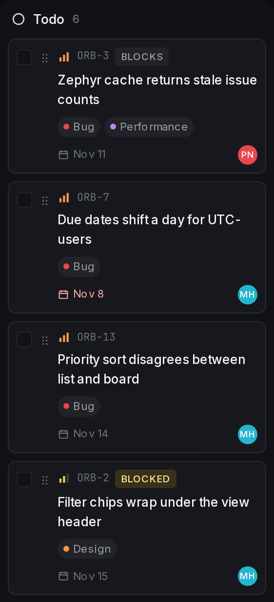
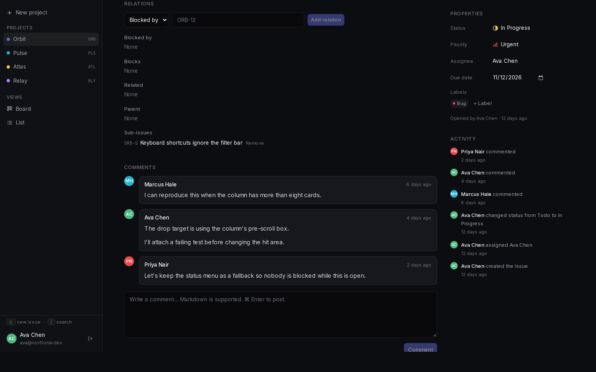
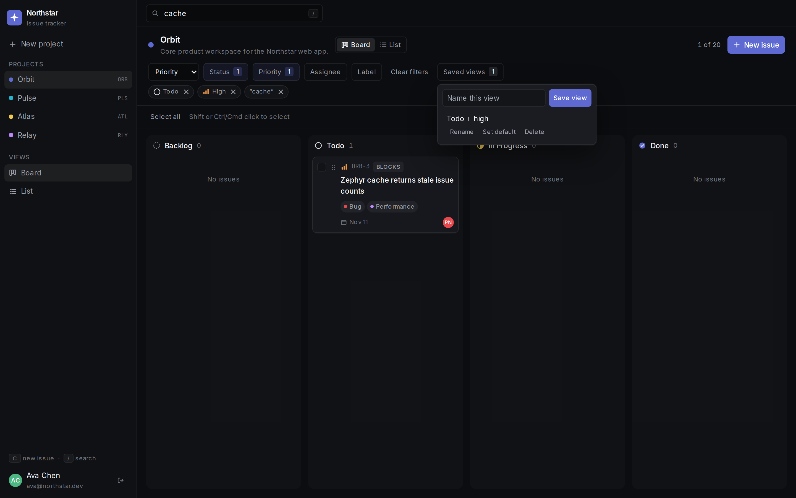
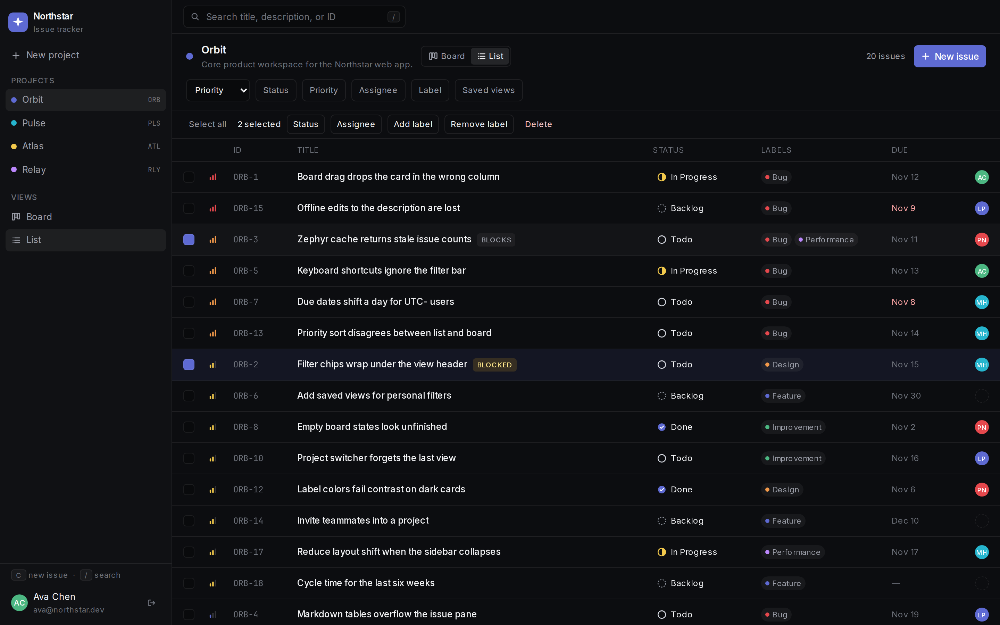
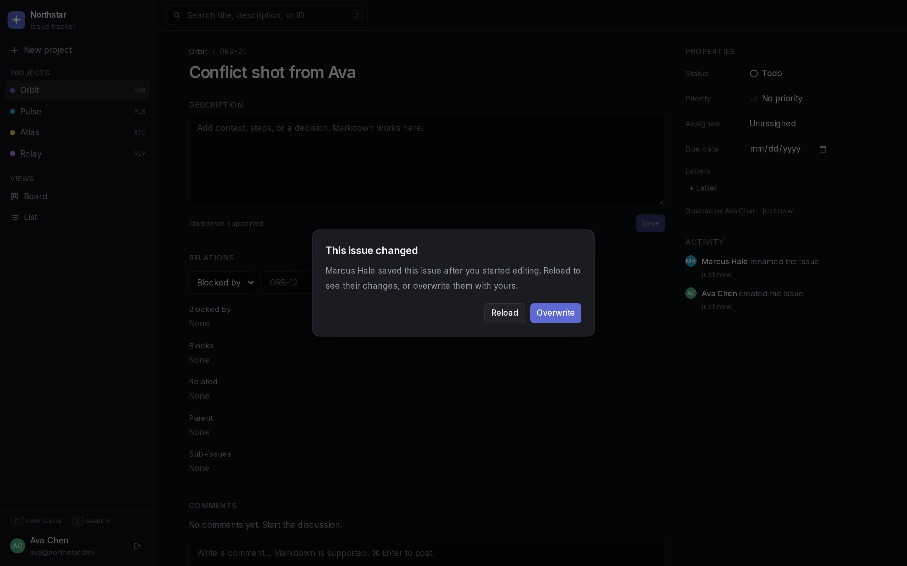
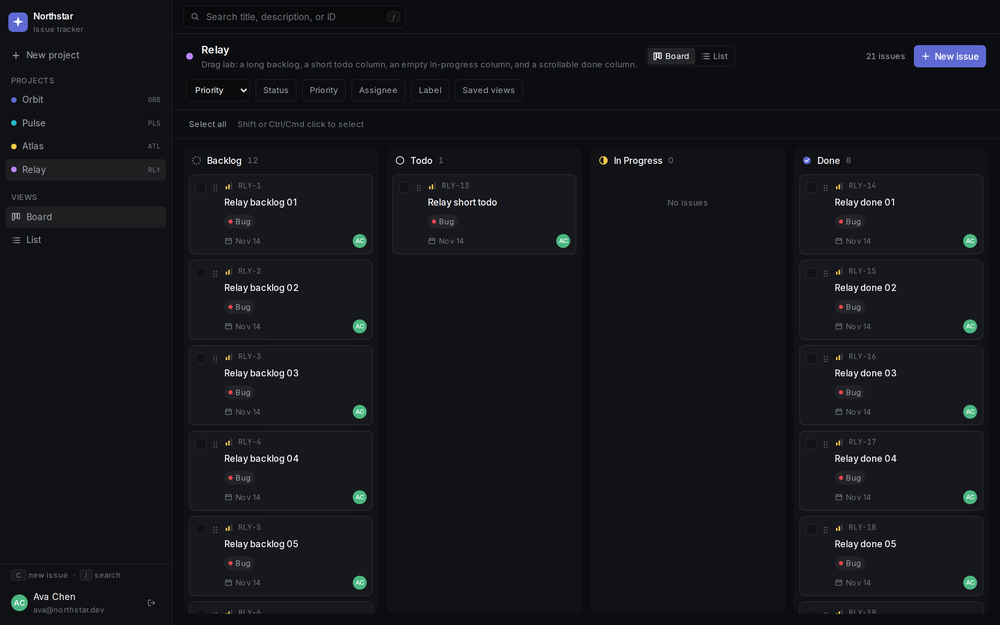
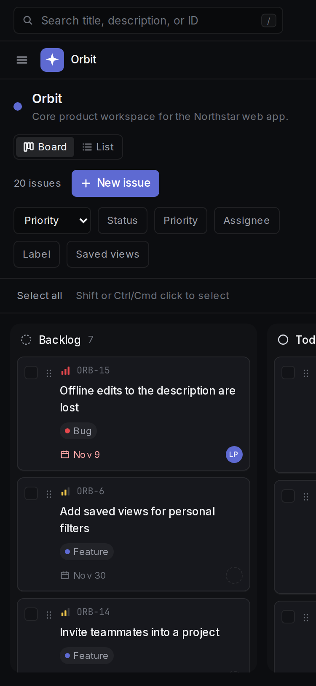

# Northstar

Northstar is a lightweight issue tracker for product teams. It covers the everyday loop: sign in, switch projects, filter a board or list, update status, and leave a Markdown comment with an activity trail.


## Features

- Email and password accounts. Passwords are hashed with bcrypt. Sessions live in an httpOnly cookie.
- Multiple projects, with the last opened project remembered across visits.
- Issues with a title, Markdown description, status, priority, assignee, due date, and labels.
- Status workflow: Backlog, Todo, In Progress, and Done.
- Kanban board with drag-and-drop between columns, plus a list view with inline status changes.
- Issue page with rendered Markdown (including tables), comments, and an activity log of who changed what and when.
- Relations on an issue: blocks, blocked by, and related to, plus one level of sub-issues. Blocking issues are marked on the board and the list. A blocking cycle is rejected.
- Saved views store the current filters, sort, and Board or List choice. Each person has their own views, can rename or delete them, and can mark one as the default for a project.
- Batch edits on the board and the list: Shift or Ctrl/Cmd click, select all, then change status, assignee, or labels, or delete after a confirmation. A partial failure lists the issues that succeeded and the ones that did not. A batch that overlaps a newer save reports that issue as a conflict instead of overwriting it.
- Concurrent edits: the issue page, the list, and a board drag send the version that was loaded. If someone else saved first, the later save stops and a prompt offers to reload their version or overwrite it.
- Filters that combine: status, priority, assignee (including unassigned), label, and keyword search across the key, title, and description. Filters stay in the URL.
- Keyboard shortcuts: `C` opens a new issue, `/` focuses search, `Esc` closes menus and dialogs, and `⌘/Ctrl+Enter` submits the issue and comment composers.
- Empty, loading, and error states for a new workspace, an empty project, a filter with no matches, and a failed page.

## Screenshots

Board, with every status column visible:


Filters combine. This view is Todo, High priority, and the keyword `cache`:


List view, sorted by priority:


Issue detail, with Markdown, comments, properties, and activity:


The Todo column on Orbit. ORB-3 shows Blocks and ORB-2 shows Blocked:



The issue page lists blocked by, blocks, related, the parent, and sub-issues. ORB-1 has ORB-5 as a sub-issue:



Saved views can be named from the current filters and switched later. This one stores Todo, High, and the keyword `cache`:



Selecting more than one issue opens the batch bar for status, assignee, labels, or delete:



If someone else saved the issue first, the later save stops and offers Reload or Overwrite:



Relay is the drag lab: a long Backlog, one Todo card, an empty In Progress column, and a long Done column:



At a phone width the sidebar is closed until you open it, and the board scrolls sideways with a card still on screen:



## Tech stack

- Next.js 15 App Router, React 19, TypeScript
- Tailwind CSS
- Prisma 6 with SQLite
- Zod for input validation
- `@dnd-kit` for board drag-and-drop
- `react-markdown` and `remark-gfm` for descriptions and comments
- Vitest for unit tests, Playwright for end-to-end tests

## Demo credentials

The seed data creates four people, all with the password `demo1234`.

| Name | Email |
| --- | --- |
| Ava Chen | ava@northstar.dev |
| Marcus Hale | marcus@northstar.dev |
| Priya Nair | priya@northstar.dev |
| Leo Park | leo@northstar.dev |

Sign in as Ava to land on **Orbit** (`ORB`). The other seeded projects are **Pulse** (`PLS`), **Atlas** (`ATL`), and **Relay** (`RLY`, a drag lab with a long column, a short column, and an empty column). Together they contain 67 issues, with labels, assignees, due dates, comments, and activity.

The sign-in page includes a **Fill demo** button that enters Ava’s email and password.

## Run locally

Requires Node.js 20 or newer.

```bash
npm install
cp .env.example .env
npm run db:setup
npm run dev
```

Open http://localhost:3000. `db:setup` creates `prisma/dev.db` and loads the demo workspace. `npm install` also generates the Prisma client.

Useful database commands:

```bash
npm run db:generate   # regenerate the Prisma client
npm run db:push       # apply schema changes to the SQLite file
npm run db:seed       # replace the current database with demo data
```

`DATABASE_URL` defaults to `file:./dev.db`, which Prisma resolves relative to the `prisma/` directory.

To refresh the screenshots in `docs/screenshots/` against a running app:

```bash
npm run screenshots
```

That script expects the app at http://127.0.0.1:3000.

## Tests

```bash
npm run lint
npm run typecheck
npm test
npm run test:e2e
```

`npm test` runs the Vitest unit suite (filters, activity copy, validation, ordering, password hashing, kanban column hit-testing, relations, saved views, batch planning, and concurrent-edit checks).

`npm run test:e2e` resets a separate SQLite file (`prisma/e2e.db`), builds the production app, and runs Playwright against http://127.0.0.1:3100. Stop `npm run dev` first. The dev server and the production build share the `.next` directory.

The end-to-end suite covers sign-in and sign-up, combined filters, project switching, list and detail status changes, Markdown comments, creating an issue, dragging a card between columns, relations, saved views, batch edits, the concurrent-edit prompt, empty and unauthorized projects, and the `C` / `/` shortcuts.

`npm run perf` repeats the 500-issue timings in `PERFORMANCE.md`: it rebuilds `prisma/perf.db`, makes a production build, and prints board, filter, and drag numbers. It does not replace the demo seed. `npm run db:perf` only rebuilds that database. A pull request also runs this check and warns if the board-load median is not under 2000 ms.

## Production deployment

Northstar is a Next.js server plus one SQLite file. Run it as a single long-lived Node process. Do not put several writers on that file, and do not expect the file to survive on a serverless host.

### Required environment

| Variable | Required | What it does |
| --- | --- | --- |
| `DATABASE_URL` | Yes | Prisma connection string. The schema is SQLite only. A `file:` path is resolved relative to the `prisma/` directory. For a real deploy, point it at an absolute path on a persistent disk, for example `file:/var/lib/northstar/prod.db`. |
| `NODE_ENV` | Set by `next start` | `production` marks the `ns_session` cookie `Secure`. |

That is the whole application environment. `.env.example` contains only `DATABASE_URL`. There is no `AUTH_SECRET`. A session is 32 random bytes stored in the `Session` table, sent in the httpOnly cookie `ns_session` (SameSite=Lax, 30 days). `next build` still needs `DATABASE_URL` to be set, even though pages render on demand.

### SQLite limits

- One process owns the file. Do not run two copies of `next start`, and do not put a load balancer in front of several replicas that write the same file. SQLite is not a multi-replica writer.
- The file has to be on a persistent disk. Replacing a container that has no volume throws the database away.
- This repo applies the schema with `prisma db push`. There is no migration history. Changing the schema on a live file is a manual `npx prisma db push` against that file, with a backup first.
- Copy the file for a backup while the process is stopped. A copy taken during writes can be incomplete.

### One Node process

This is the deployment that matches the database.

```bash
npm ci
cp .env.example .env
# Set DATABASE_URL to an absolute file on a persistent disk.
npx prisma db push
npm run build
npm run start
```

`npm run start` is `next start`. It listens on port 3000 unless you pass `-p`. Put TLS on a reverse proxy in front of that single process. Do not scale the process out.

Do not run `npm run db:seed` or `npm run db:setup` on the production file unless you mean to replace every row with the demo workspace.

### Vercel and other serverless hosts

Vercel can build this Next.js app. It cannot host this SQLite file. Serverless instances do not share a writable disk, `/tmp` disappears, and each instance would see its own empty or stale database. A later request can land on a different instance and miss the write. Two instances writing one SQLite file is the case this app does not support.

Do not deploy with `DATABASE_URL=file:./dev.db` and expect issues to stick. A public multi-instance deploy needs a database that accepts many connections, which means changing the Prisma datasource off SQLite. This repository does not do that. Until it does, run `next start` on one machine.

### Change these before the site is public

- The seed creates Ava Chen, Marcus Hale, Priya Nair, and Leo Park, all with the password `demo1234`. Those accounts are fixtures. On a public server, start from an empty file, or change every password and delete the accounts you do not want.
- The sign-in page prints `ava@northstar.dev · demo1234` and offers a Fill demo button (`src/components/auth-form.tsx`). Remove that block before the site is public.
- Sign-in has no rate limit, no email verification, and no password reset. Passwords are bcrypt with 10 rounds. Treat the accounts as demo-grade until that changes.
