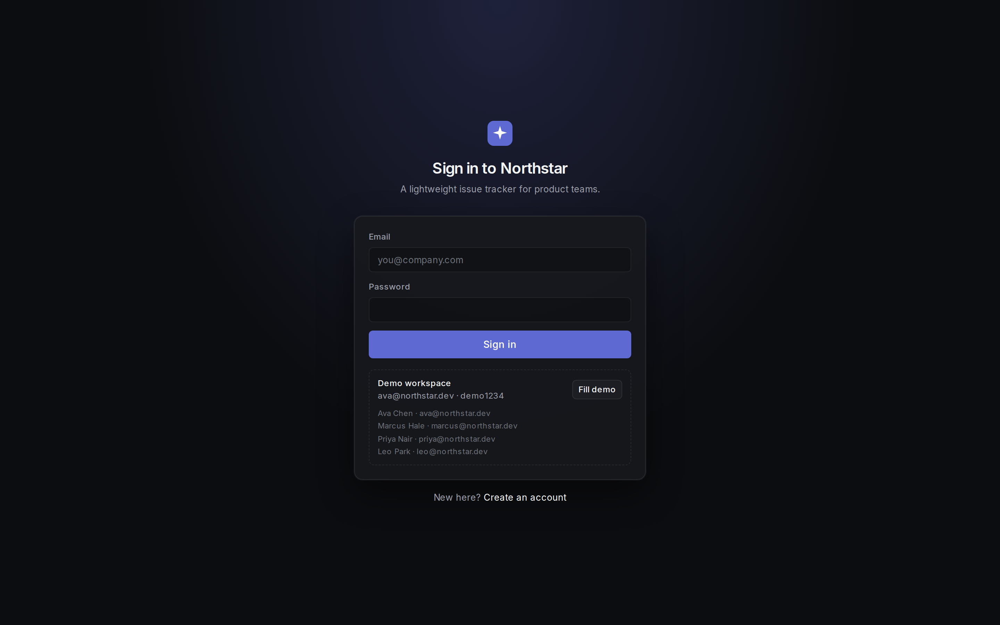
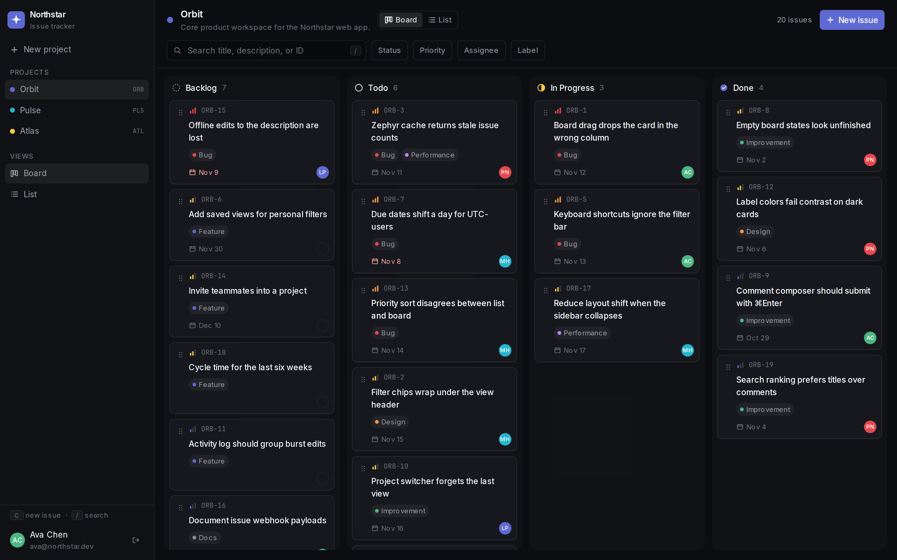
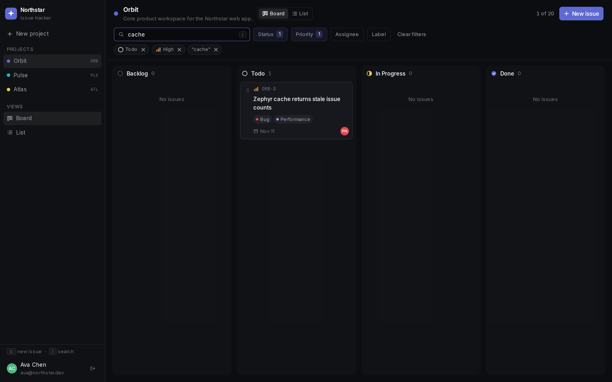
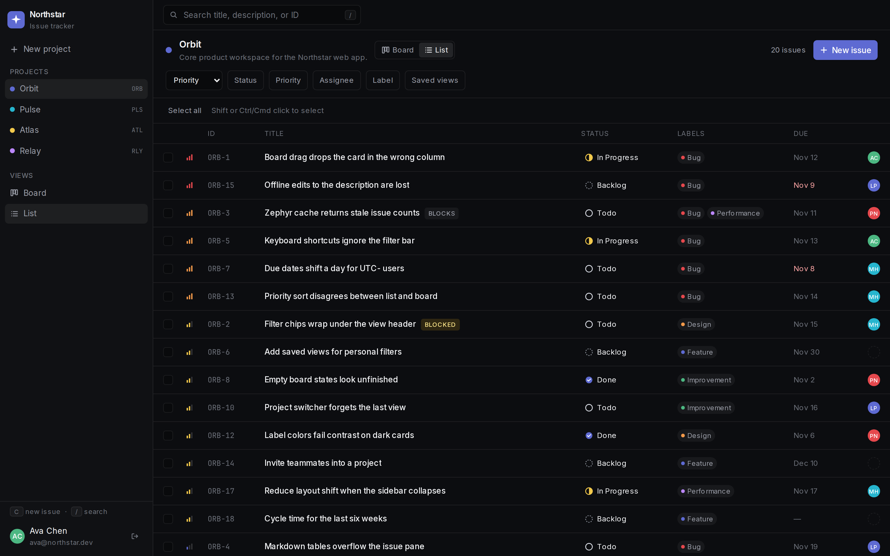
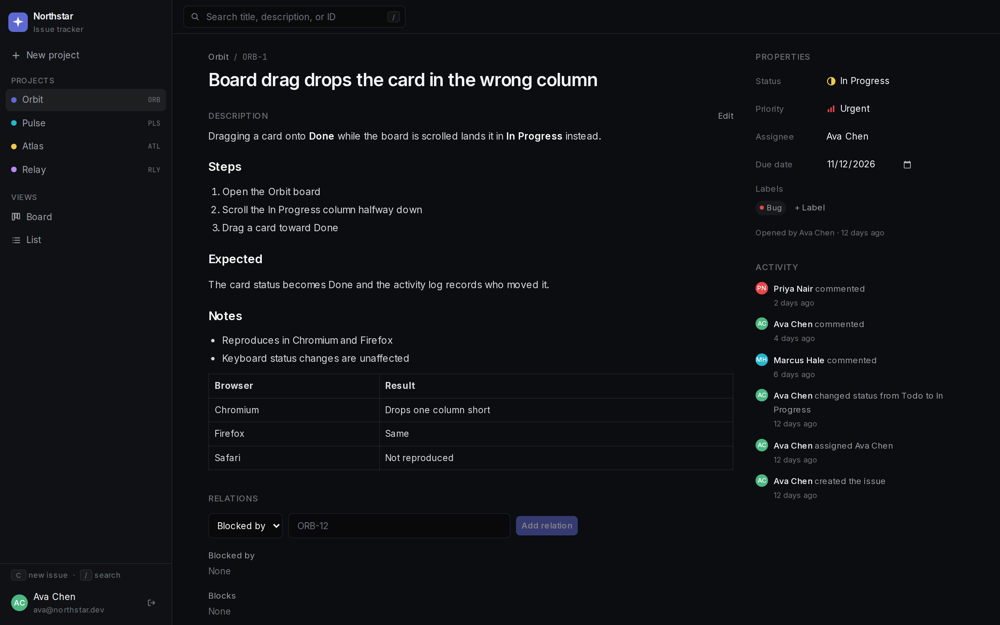

# Northstar

Northstar is a lightweight issue tracker for product teams. It covers the everyday loop: sign in, switch projects, filter a board or list, update status, and leave a Markdown comment with an activity trail.



## Features

- Email and password accounts. Passwords are hashed with bcrypt. Sessions live in an httpOnly cookie.
- Multiple projects, with the last opened project remembered across visits.
- Issues with a title, Markdown description, status, priority, assignee, due date, and labels.
- Status workflow: Backlog, Todo, In Progress, and Done.
- Kanban board with drag-and-drop between columns, plus a list view with inline status changes.
- Issue page with rendered Markdown (including tables), comments, and an activity log of who changed what and when.
- Relations on an issue: blocks, blocked by, and related to, plus one level of sub-issues. Blocking issues are marked on the board and the list. A blocking cycle is rejected.
- Saved views store the current filters, sort, and Board or List choice. Each person has their own views, can rename or delete them, and can mark one as the default for a project.
- Filters that combine: status, priority, assignee (including unassigned), label, and keyword search across the key, title, and description. Filters stay in the URL.
- Keyboard shortcuts: `C` opens a new issue, `/` focuses search, `Esc` closes menus and dialogs, and `⌘/Ctrl+Enter` submits the issue and comment composers.
- Empty, loading, and error states for a new workspace, an empty project, a filter with no matches, and a failed page.

## Screenshots

Board, with every status column visible:



Filters combine. This view is Todo, High priority, and the keyword `cache`:



List view, sorted by priority:



Issue detail, with Markdown, comments, properties, and activity:



## Tech stack

- Next.js 15 App Router, React 19, TypeScript
- Tailwind CSS
- Prisma 6 with SQLite
- Zod for input validation
- `@dnd-kit` for board drag-and-drop
- `react-markdown` and `remark-gfm` for descriptions and comments
- Vitest for unit tests, Playwright for end-to-end tests

## Demo credentials

The seed data creates four people, all with the password `demo1234`.

| Name | Email |
| --- | --- |
| Ava Chen | ava@northstar.dev |
| Marcus Hale | marcus@northstar.dev |
| Priya Nair | priya@northstar.dev |
| Leo Park | leo@northstar.dev |

Sign in as Ava to land on **Orbit** (`ORB`). The other seeded projects are **Pulse** (`PLS`), **Atlas** (`ATL`), and **Relay** (`RLY`, a drag lab with a long column, a short column, and an empty column). Together they contain 67 issues, with labels, assignees, due dates, comments, and activity.

The sign-in page includes a **Fill demo** button that enters Ava’s email and password.

## Run locally

Requires Node.js 20 or newer.

```bash
npm install
cp .env.example .env
npm run db:setup
npm run dev
```

Open http://localhost:3000. `db:setup` creates `prisma/dev.db` and loads the demo workspace. `npm install` also generates the Prisma client.

Useful database commands:

```bash
npm run db:generate   # regenerate the Prisma client
npm run db:push       # apply schema changes to the SQLite file
npm run db:seed       # replace the current database with demo data
```

`DATABASE_URL` defaults to `file:./dev.db`, which Prisma resolves relative to the `prisma/` directory.

To refresh the screenshots in `docs/screenshots/` against a running app:

```bash
npm run screenshots
```

That script expects the app at http://127.0.0.1:3000.

## Tests

```bash
npm run lint
npm run typecheck
npm test
npm run test:e2e
```

`npm test` runs the Vitest unit suite (filters, activity copy, validation, ordering, password hashing, and kanban column hit-testing).

`npm run test:e2e` resets a separate SQLite file (`prisma/e2e.db`), builds the production app, and runs Playwright against http://127.0.0.1:3100. Stop `npm run dev` first. The dev server and the production build share the `.next` directory.

The end-to-end suite covers sign-in and sign-up, combined filters, project switching, list and detail status changes, Markdown comments, creating an issue, dragging a card between columns, and the `C` / `/` shortcuts.
